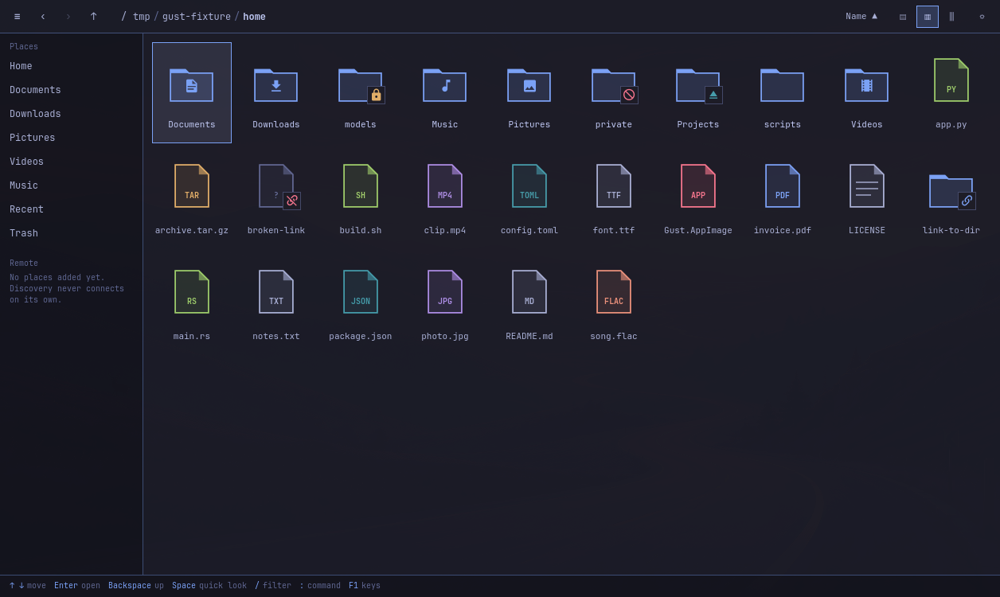
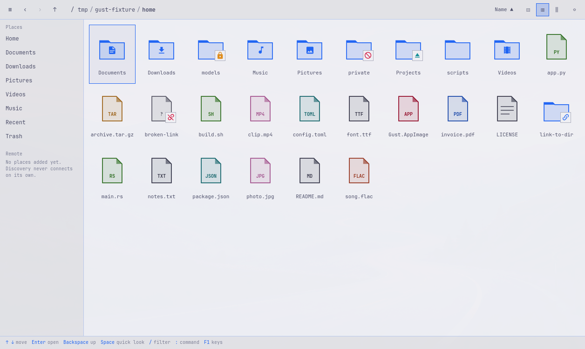
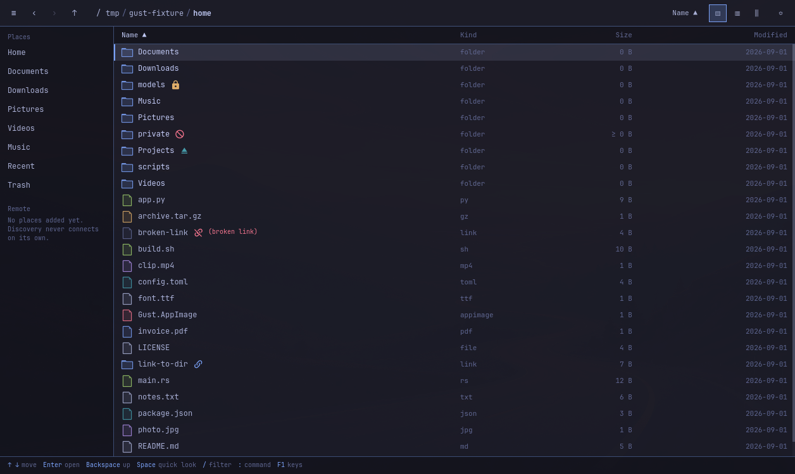

# GUST

A fast, calm file manager for Omarchy. One Rust binary, Qt Quick UI (cxx-qt), MIT.

<p align="center">
  
  
</p>
<p align="center">
  
</p>

> **Status: M1 complete, M2 started.** Listing, three views, navigation, filter,
> search, theming, keyboard and the safety primitives are proven on a real
> Omarchy desktop, and Trash + Undo are wired end to end. Copy/move/rename have
> tested engines but no UI path yet; remote is scaffolding only. Section
> [What is proven](#what-is-actually-proven) says exactly what has been run.

## Build and run

```
just build      # cargo build --workspace
just test       # library tests (no display needed)
just lint       # fmt, clippy, QML token discipline
just qa         # drives the REAL window with REAL key events
just theme-matrix   # screenshots every installed Omarchy theme
```

Requires Rust 1.90+, Qt 6.11, and a Wayland session for the QA targets.

## Layout

| Path | What lives there |
| --- | --- |
| `crates/core` | listing, watch, sort, MIME, search, theme tokens — no Qt |
| `crates/ops` | copy/move/trash/rename, jobs, undo journal, archive policy |
| `crates/remote` | SSH config parsing, capability probing, upload tracking |
| `crates/thumbs` | freedesktop cache + sandboxed thumbnailer contract |
| `crates/app` | cxx-qt bridge, models, main |
| `ui/` | QML views; `ui/Tokens.qml` is the only place values are defined |
| `docs/DESIGN.md` | types and protocols shared between crates — change it first |
| `tests/` | fixture builder, desktop QA, theme matrix, screenshot assertions |

## The rules this code actually follows

- **No colour, font, radius or spacing literal in QML.** Tokens only, read from
  `~/.local/state/omarchy/current/theme/{colors,shell}.toml`. `just lint` fails
  the build if a literal appears. A theme that omits a token gets a complete
  built-in fallback, never a magenta hole.
- **Destructive paths ship with a test for the confirmation and the undo.**
  Trash and permanent delete have different wording and different confirmations;
  an irreversible delete focuses Cancel.
- **Undo verifies subtree identity.** Root inode+mtime is not a fingerprint:
  every descendant is checked, and undo refuses if anything changed or new work
  appeared.
- **Untrusted bytes run sandboxed or not at all** — `bwrap --unshare-all` plus
  `prlimit`, with the parent validating helper output through a held descriptor.
- **No secret in argv, env, logs or config files.**
- **The UI thread never touches the filesystem**; every listing carries a
  cancel token and a generation so stale results are dropped.
- **Executables never launch from browsing.** Activation returns
  `blocked:executable needs a deliberate Run action`.

## What is actually proven

Everything below was run on Omarchy 4.0.3 (Qt 6.11.2, Rust 1.98.1,
cxx-qt 0.10.0) in an authorised VM, against a throwaway fixture.

| Gate | Evidence |
| --- | --- |
| Library behaviour | 141 tests, `just test` |
| Desktop interaction | 61 assertions driving the real window with real key events, `just qa` |
| Theme coverage | all 22 installed themes render with their own colours, `just theme-matrix` |
| Token discipline | `just lint` rejects QML literals and `QtQuick.Controls` |

Trash is wired end to end: confirm → the file moves to the freedesktop trash →
Ctrl+Z restores it, and undo refuses (preserving both files) if new work has
taken the original path. Not yet done, and not claimed: copy/move/rename in the
UI, remote backends, thumbnails, tabs and panes, drag and drop, packaging. See
`docs/STATUS.md` for the honest per-feature list.

## Omarchy integration

Gust is an ordinary application: stable app id, XDG paths, no imports from
Omarchy's private shell tree. It reads theme tokens through its own adapter and
watches the parent of `current` so an atomic theme swap is observed.
